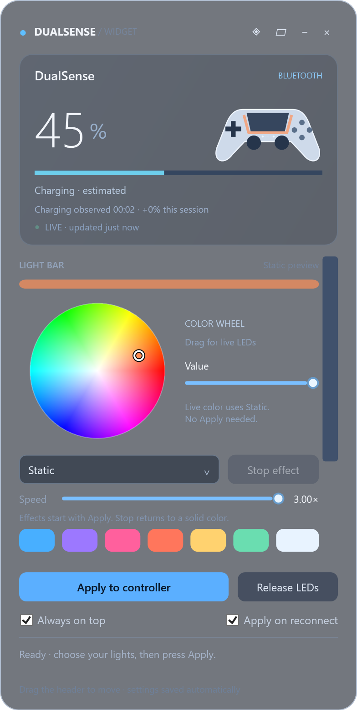

# Controller Lights and Battery

A movable Windows desktop widget for DualSense battery status, charging information, and controller lighting.

Previously called DualSense Widget. Version 1.5.2 uses the new name throughout the interface and download. Existing saved preferences are preserved.



## Download

Get **ControllerLightsAndBattery-v1.5.2-win-x64.zip** from [Releases](https://github.com/asavinon/dualsense-widget/releases/latest), extract it, and run `ControllerLightsAndBattery.exe`.

Windows x64 is required. The .NET runtime is included; no separate runtime installation or administrator rights are needed. This release is unsigned.

## Features

- Estimated battery percentage, live/stale report indicator, charging status, and observed charging duration and gain.
- Drag the header to move the widget; compact view, always-on-top option, tray icon, and saved settings.
- Glass, translucent, and dark themes with adjustable surface opacity.
- Radial HSV picker with live controller updates while dragging, plus RGB, hex, brightness, and presets.
- Individual player indicator LEDs and Static, Rainbow, Breathe, Player chase, and Battery reactive effects.
- USB and Bluetooth support, automatic reconnect, and optional restore of saved lighting.

Using the radial picker or its Value slider immediately selects Static lighting and updates the controller. Other lighting and effect controls are previewed until **Apply to controller** is pressed. **Release LEDs** returns lighting control to the firmware.

See the [user guide](docs/USER-GUIDE.txt) for controls and troubleshooting.

## Compatibility and limits

- DualSense reports charge in coarse bands. The displayed percentage is an estimate, not a precise 1% measurement.
- DualSense Edge support is implemented but has not been hardware-tested. One controller is used at a time, preferring USB.
- Live Bluetooth battery reports and LED write access were verified on a DualSense. USB framing is covered by automated checks; physical LED behavior still needs broader hardware testing.
- Charging current, wattage, and time-to-full are unavailable from the reports used here.
- Glass uses styled transparency without desktop blur.
- Steam, DS4Windows, games, or HidHide may interfere with controller access or overwrite lighting.

## Build and check

Use Windows with the .NET 10 SDK:

```powershell
dotnet run --project ProtocolTests/ProtocolTests.csproj -c Release
dotnet publish DualSenseWidget/DualSenseWidget.csproj -c Release -r win-x64 --self-contained true -p:PublishSingleFile=true -p:IncludeNativeLibrariesForSelfExtract=true -p:EnableCompressionInSingleFile=true -o publish
```

The dependency-free check runner covers protocol framing, CRC, charge states, charging sessions, LED flags, animation timing, and coalesced live color updates. Version 1.5.2 passed 96 checks.

To inspect a connected controller without changing its LEDs:

```powershell
dotnet run --project ProtocolTests/ProtocolTests.csproj -c Release -- --probe
```

## Local data

Settings are stored in `%LOCALAPPDATA%\DualSenseWidget\settings.json`. The app does not use a network service, install a background service, or register itself to start with Windows.

## License and acknowledgements

The widget source is licensed under the [MIT license](LICENSE). Bundled .NET runtime components retain their own licenses and notices in [licenses](licenses).

Protocol references: [Sony-authored upstream Linux HID driver](https://github.com/torvalds/linux/blob/master/drivers/hid/hid-playstation.c) and [Microsoft HID report documentation](https://learn.microsoft.com/en-us/windows-hardware/drivers/hid/obtaining-hid-reports). The C# implementation is independent.

This project is not affiliated with or endorsed by Sony. DualSense and PlayStation are trademarks of their respective owners.
